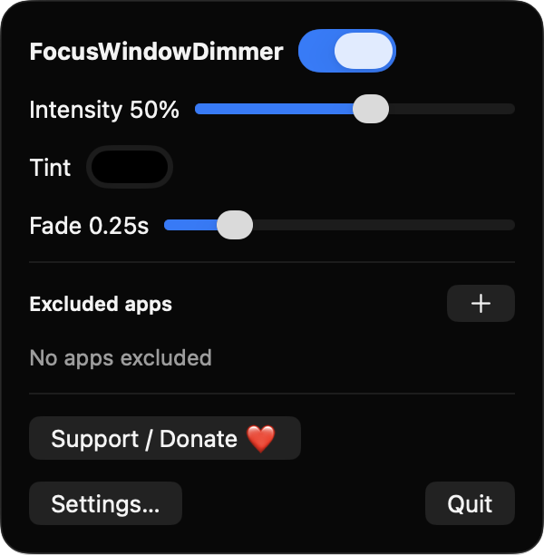
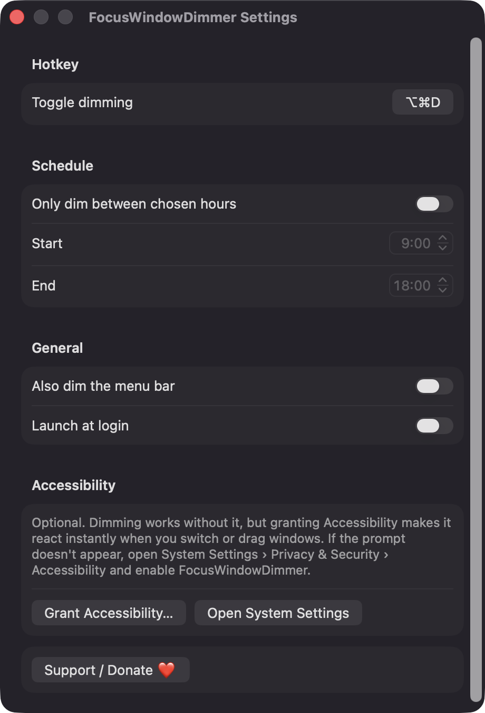

# FocusWindowDimmer

**🌐 Website:** [turhe123.github.io/focus-window-dimmer](https://turhe123.github.io/focus-window-dimmer/)

Dim everything behind the active window so your eyes and attention stay on the one thing you are working on.


## Why

FocusWindowDimmer is a free, open-source, 100% native, backend-free alternative to paid utilities in the *Focus & Productivity* category. It was inspired by HazeOver ($4.99 one-time), a well-liked app that does this job nicely. This version aims to cover the same core idea, with no account, no network and no cost.

## Features

- **Dims every window except the frontmost one**, on every connected display. A click-through overlay sits directly beneath the active app's top window.
- **Intensity slider** from 0% to 90%.
- **Tint color**: use black or pick any color for the overlay.
- **Fade animation** with an adjustable duration (0–1.5 s).
- **Optionally dim the menu bar** too.
- **Excluded apps**: pick running apps that should never be dimmed. Dimming turns off while an excluded app is active.
- **Global hotkey** to toggle dimming (default ⌥⌘D). You can record your own combination in Settings.
- **Schedule**: only dim between chosen start and end times. Ranges that wrap past midnight work.
- **Menu bar app** with a moon icon (filled when on, outline when off). It has no Dock icon.
- **Launch at login** via `SMAppService`.
- **Spaces, full-screen apps and display changes**: overlays join all Spaces and are rebuilt when you switch Spaces or plug or unplug a display.
- **Fades out when the frontmost app has no window.**
- **Optional Accessibility support** for instant reaction to window focus changes and drags. Without it, a 5 Hz timer keeps things in sync.

## Screenshots

<p align="center"></p>

<p align="center"><em>The menu bar popover lets you switch dimming on or off, set intensity, tint and fade duration, and manage excluded apps.</em></p>

<p align="center"></p>

<p align="center"><em>Settings let you record a global hotkey, set a dimming schedule, dim the menu bar, launch at login, and turn on optional Accessibility support.</em></p>

## Install

1. Download `FocusWindowDimmer-macOS.zip` from the [latest release](https://github.com/turhe123/focus-window-dimmer/releases/latest).
2. Unzip it and move `FocusWindowDimmer.app` to `/Applications`.
3. The app is open source and not notarized, so remove the quarantine attribute:

   ```bash
   xattr -cr /Applications/FocusWindowDimmer.app
   ```

4. The first time, right-click the app and choose **Open**.

Requires macOS 14.0 or later.

## Build from source

```bash
brew install xcodegen
xcodegen generate
xcodebuild -project FocusWindowDimmer.xcodeproj -scheme FocusWindowDimmer -configuration Release -derivedDataPath ./build build
```

The app is produced at `build/Build/Products/Release/FocusWindowDimmer.app`.

## Permissions

| Permission | Required? | Why |
| --- | --- | --- |
| Accessibility | Optional, requested only when you click "Grant Accessibility…" in Settings | Lets the app observe focus-change and window-move events of the frontmost app so the dimming layer re-orders instantly. Without it, dimming still works and relies on app-switch notifications plus a 5 Hz timer. |

The app does **not** request Screen Recording or Microphone access, or any other permission. It reads the public window list (owner, layer, bounds) only to find the frontmost app's top window. It never captures screen contents. "Launch at login" uses the system login-item API, and macOS may show its own notice when you enable it.

## Built with AI

FocusWindowDimmer was written by [Claude Code](https://claude.com/claude-code) inside an automated pipeline, from a plain-English spec. No code, binaries or assets from any commercial app were used; it is a clean-room reimplementation of a feature set, not a copy.

What that means in practice:

- The full source is in this repo under the MIT license. Read it before you run it.
- No network calls, no analytics, no third-party dependencies. Only Apple frameworks.
- Ad-hoc signed and not notarized, which is why Gatekeeper warns on first launch.
- It has had less human review than a hand-written app. Bug reports and pull requests are welcome.

## Support ❤️

FocusWindowDimmer is free. If it helps you focus, you can support its development:

[Support Or (Leo) Davidai ❤️ on Ko-fi](https://ko-fi.com/leodavidai)

## License

MIT © Or Davidai Bachar
